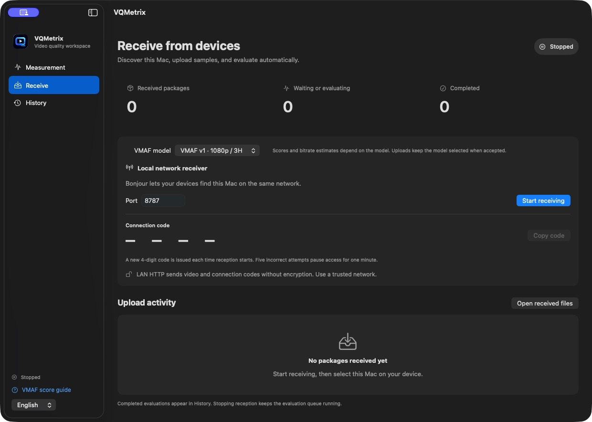

# 📊 [VQMetrix](https://haishinkit.github.io/VQMetrix/)

[](https://github.com/HaishinKit/VQMetrix/actions/workflows/build.yml)
[](Android/README.md)
[](LICENSE.md)

Video quality development tools built on HaishinKit.

- **macOS:** compare reference and decoded video, change H.264/HEVC and bitrate, inspect VMAF and sender performance, and review saved runs and HTML reports.
- **Android (HaishinKit Example):** create exact YUV references from a camera or test pattern, encode bitrate variants, and prepare checksummed upload packages.
- **Transfer:** LAN HTTP / HTTPS upload client and Bonjour discovery with a versioned package format. The macOS app receives LAN HTTP uploads, advertises Bonjour, and queues VMAF evaluations into History.

## 🖥️ macOS app

Measure locally, receive device samples, and review saved results from the sidebar.
The app supports English and Japanese and follows the system appearance.


Actual measurement of a synthetic 720p clip, encoded as H.264 at 0.5 Mbps.
The displayed scores belong to this run, not a general codec benchmark.



Start Receive to advertise this Mac through Bonjour. Enter its session-specific
4-digit connection code on the sending device. LAN HTTP uploads are validated,
evaluated serially, and saved to History with HTML report export.

## 📦 Android library

Add JitPack to the consuming project's repositories, then use:

```kotlin
implementation("com.github.HaishinKit:VQMetrix:1.0.0")
```

See [Android installation](Android/README.md) for the complete repository setup.
The transfer library supports API 26+ and has no HaishinKit dependency.
Capture/encoding UI lives in HaishinKit.kt Example (API 29+).

## 🚀 Build

App release builds use HaishinKit.swift and HaishinKit.kt beside this checkout at the revisions in
[Support/dependencies.json](Support/dependencies.json), then prepare their development adapters:

```sh
ruby Scripts/prepare_dependencies.rb
```

macOS (Swift 6, macOS 13+; the installed libvmaf can require a newer OS):

```sh
brew install libvmaf pkgconf
ruby Scripts/build_app.rb
open .build/VQMetrix.app
```

Android (JDK 17+, SDK 37):

```sh
cd ../HaishinKit.kt
./gradlew :app:assembleDebug
```

These use local development checkouts, not published release tags. The adapters and
pinned revisions make CI reproduce the same build. See the [Android guide](Android/README.md)
for the external artifact and Example integration.

## 📚 Documentation

[Published documentation](https://haishinkit.github.io/VQMetrix/) · [VMAF score guide](https://haishinkit.github.io/VQMetrix/swift/documentation/vqmetrixcore/understandingvmaf/) · [User guide](docs/user-guide.md) · [Transfer protocol](docs/transfer.md) · [Release workflow](docs/releases.md)

Tags generate Swift DocC, Android Dokka, and a combined API-reference archive. Extract
it and run `ruby serve.rb` to read it locally. GitHub Pages hosts the product page and generated reference.

## 🧪 Verification

```sh
swift test
cd Android
./gradlew :transfer:testDebugUnitTest
```

VideoToolbox integration tests and Android device tests require suitable hardware.
App languages are English and Japanese. Evaluation packages contain video only. macOS camera input
is experimental; capture availability depends on the device and environment.

## 📦 Development builds

The `1.0.0` tag attaches a macOS ZIP, Android transfer library, API documentation, and
checksums to [GitHub Release](https://github.com/HaishinKit/VQMetrix/releases). macOS builds
are ad hoc signed and not notarized. Android Example APK distribution is managed by HaishinKit.kt.

## ⚖️ Licenses

VQMetrix and HaishinKit use BSD-3-Clause. libvmaf uses
[BSD-2-Clause-Patent](https://github.com/Netflix/vmaf/blob/master/LICENSE).
The macOS package includes dependency license notices. Preserve them when distributing it.
