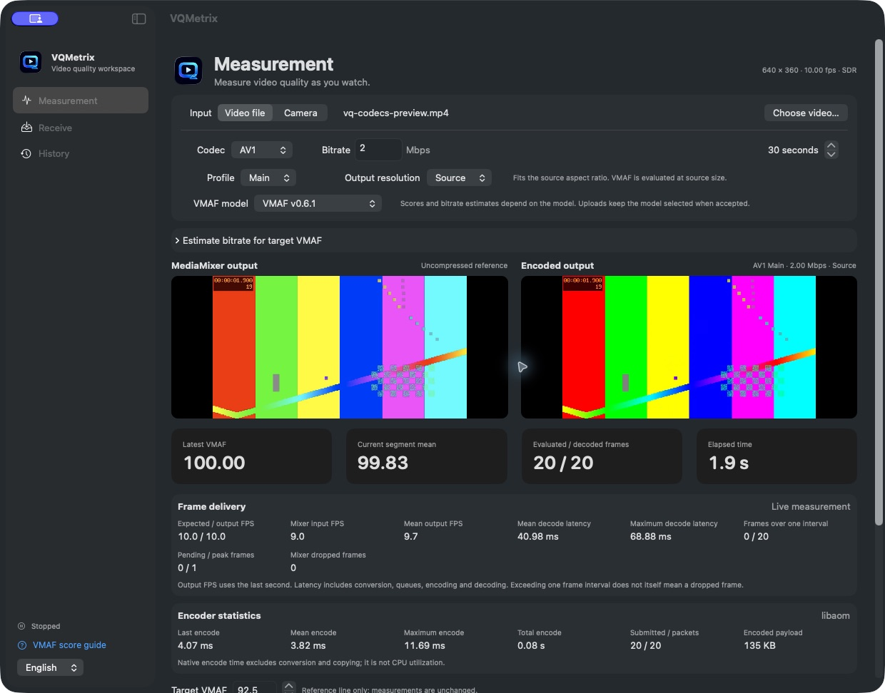
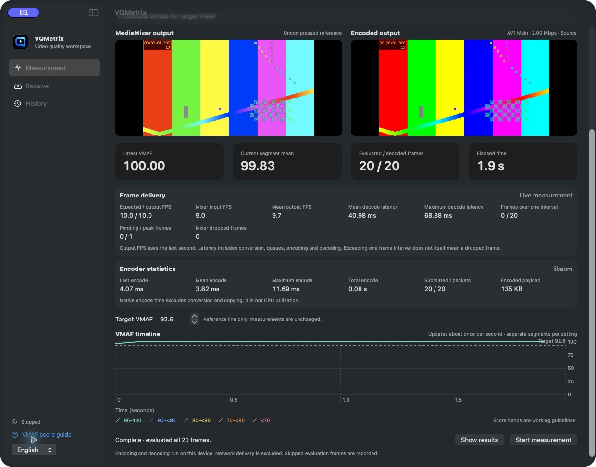
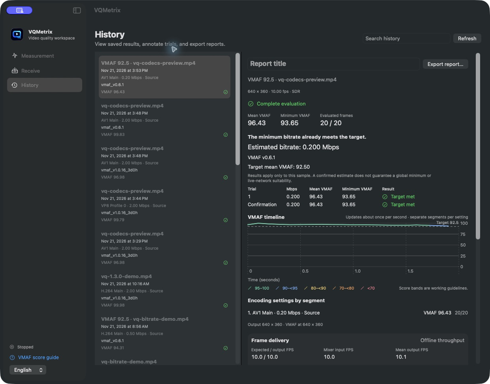

# 📊 [VQMetrix](https://haishinkit.github.io/VQMetrix/)

[](https://github.com/HaishinKit/VQMetrix/actions/workflows/build.yml)
[](https://jitpack.io/#HaishinKit/VQMetrix)
[](Android/README.md)
[](LICENSE.md)

Video quality development tools built on HaishinKit.

- **macOS:** choose VMAF v1 or v0.6.1, compare reference and decoded video, change H.264/HEVC/VP8/VP9/AV1 and bitrate, inspect VMAF and encoder/sender statistics, estimate bitrate for a target mean VMAF, and review saved runs and HTML reports.
- **Android (HaishinKit Example):** create exact YUV references from a camera or test pattern, encode bitrate variants, and prepare checksummed upload packages.
- **Transfer:** LAN HTTP / HTTPS upload client and Bonjour discovery with a versioned package format. The macOS app receives LAN HTTP uploads, advertises Bonjour, and queues VMAF evaluations into History.

## 🖥️ macOS app

Measure locally, receive device samples, and review saved results from the sidebar.
The app supports English and Japanese and follows the system appearance.
Choose VMAF v1 (default) or v0.6.1 before measuring or searching. Models and evaluation settings are retained with each result.
See the [model guide](https://haishinkit.github.io/VQMetrix/swift/documentation/vqmetrix/evaluationmodels/) for comparison limits.



Local AV1 Main evaluation at 2 Mbps, using VMAF v0.6.1 and twenty synthetic 640×360 frames.
The displayed scores apply to this sample, not to AV1 in general.



Inspect input/output FPS, queueing, drops, and pipeline latency alongside native encoder timing.
The timeline shows five score bands and a target line at 92.5. Statistics are saved per segment in History and HTML reports.



A saved AV1/v0.6.1 search targeting mean VMAF 92.5. The configured lower bound of
0.2 Mbps met the target and passed confirmation for this sample; it is not a global minimum.
See the [bitrate search guide](https://haishinkit.github.io/VQMetrix/swift/documentation/vqmetrix/bitratesearch/).


Start Receive to advertise this Mac through Bonjour. Enter its session-specific
4-digit connection code on the sending device. LAN HTTP uploads are validated,
evaluated serially, and saved to History with HTML report export.

## 📦 Android library

Add JitPack to the consuming project's repositories, then use:

```kotlin
implementation("com.github.HaishinKit:VQMetrix:1.4.0")
```

See [Android installation](Android/README.md) for the complete repository setup.
The transfer library supports API 26+ and has no HaishinKit dependency.
Capture/encoding UI lives in HaishinKit.kt Example (API 29+).

## 🚀 Build

macOS builds use HaishinKit.swift beside this checkout at the revision in
[Support/dependencies.json](Support/dependencies.json), then prepare their development adapters. The pin references HaishinKit.swift main with VPXHaishinKit and AOMHaishinKit merged; it is a commit reference rather than an SDK release tag:

```sh
ruby Scripts/prepare_dependencies.rb swift
```

macOS (Swift 6, macOS 13+; the installed libvmaf can require a newer OS):

```sh
brew install libvmaf pkgconf
ruby Scripts/build_app.rb
open .build/VQMetrix.app
```

Android (JDK 17+, SDK 37):

```sh
cd Android
./gradlew :transfer:assembleRelease
```

These use local development checkouts, not published release tags. The adapters and
pinned revisions make CI reproduce the same build. See the [Android guide](Android/README.md)
for the external artifact and Example integration.

## 📚 Documentation

[Published documentation](https://haishinkit.github.io/VQMetrix/) · [VMAF score guide](https://haishinkit.github.io/VQMetrix/swift/documentation/vqmetrix/understandingvmaf/) · [User guide](docs/user-guide.md) · [Transfer protocol](docs/transfer.md) · [Release workflow](docs/releases.md)

Tags generate English/Japanese DocC app guides, Android Dokka, and a combined API-reference archive. Extract
it and run `ruby serve.rb` to read it locally. GitHub Pages hosts the product page and generated reference.

## 🧪 Verification

```sh
swift test
cd Android
./gradlew :transfer:testDebugUnitTest
```

VideoToolbox integration tests and Android device tests require suitable hardware.
App languages are English and Japanese. Evaluation packages contain video only. macOS camera input
is experimental; capture availability depends on the device and environment.

## 📦 Development builds

The `1.4.0` tag attaches a macOS ZIP, Android transfer library, API documentation, and
checksums to [GitHub Release](https://github.com/HaishinKit/VQMetrix/releases). macOS builds
are ad hoc signed and not notarized. Android Example APK distribution is managed by HaishinKit.kt.

## 🔓 First launch on macOS

The download is ad hoc signed and **not notarized by Apple**, so macOS may show “Apple could not verify VQMetrix is free of malware.” If you trust the download from this repository:

1. Extract the ZIP, move VQMetrix to Applications, and try opening it once.
2. Open **System Settings → Privacy & Security**, then select **Open Anyway** for VQMetrix.
3. Confirm **Open** and authenticate if prompted.

See [Apple’s instructions](https://support.apple.com/en-us/102445). This permits this app; do not disable Gatekeeper globally. A warning that malware was detected or the app is damaged is a different issue.

Version 1.0.1 adds in-app update checks. Users of 1.0.0 need one manual update;
see [automatic updates](docs/automatic-updates.md).

## ⚖️ Licenses

VQMetrix and HaishinKit use BSD-3-Clause. libvmaf uses
[BSD-2-Clause-Patent](https://github.com/Netflix/vmaf/blob/master/LICENSE).
The macOS package includes dependency license notices. Preserve them when distributing it.
